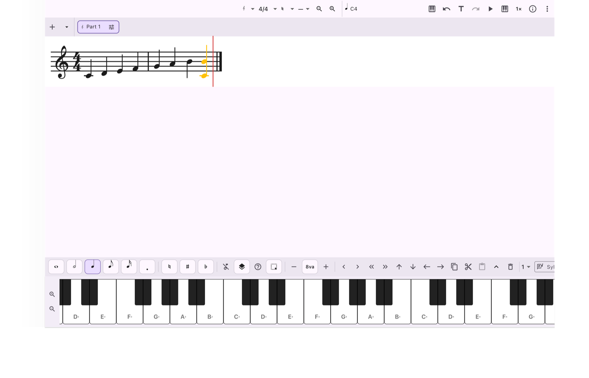
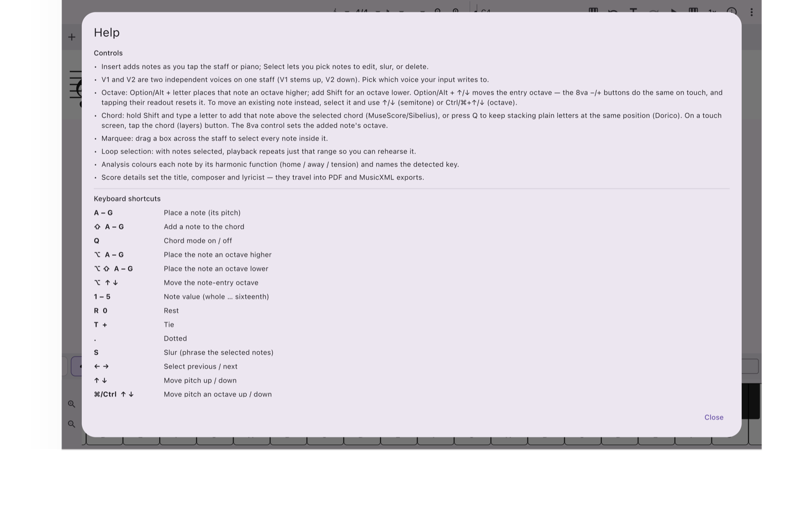

# CometBeat — Score & Tab Workshop guide

A short, practical guide to note entry in the **Score Workshop** and **Tab
Workshop**. Everything here also works on a touch screen; the keyboard shortcuts
are an accelerator, not a requirement.

> **Where is it?** Studio tools are off on a new install. Turn them on under
> **Settings ▸ Studio tools**; the Workshop then opens from the piano menu on
> the home screen (or from the Authoring menu).

---

## 1. The two editors

| Editor | Best for | Opens from |
|---|---|---|
| **Score Workshop** | melody, chords, several instruments on staves | piano menu → Score Workshop |
| **Tab Workshop** | guitar/bass/ukulele tablature and fret entry | piano menu → Tab Workshop |

Both use the same input bar at the bottom: note values, dot, accidentals, rest,
chord mode, the `8va` octave control and the `(?)` help button.

---

## 2. Entering notes (computer keyboard)

| Key | Action |
|---|---|
| `A` – `G` | place that note at the caret |
| `1` – `5` | note value (whole → sixteenth) |
| `.` | dot |
| `R` or `0` | rest |
| `T` or `+` | tie |
| `S` | slur |
| `Del` / `⌫` | delete the selected note |
| `←` `→` | move the caret / selection |
| `↑` `↓` | move the selected note a semitone |
| `Ctrl/⌘ + ↑ ↓` | move the selected note an octave |
| `Ctrl/⌘ + Z` / `Y` | undo / redo |
| `Ctrl/⌘ + C X V` | copy / cut / paste |

**The entry octave is fixed.** Typing `cdefgabc` stays in one octave; it does
**not** climb an octave each time you repeat the run. A `C` after a `B` is the
`C` in the same octave, not the one above.

---

## 3. Octaves while placing notes

| Input | Result |
|---|---|
| `Option/Alt` + letter | that note **one octave higher** |
| `Option/Alt` + `Shift` + letter | that note **one octave lower** |
| `Option/Alt` + `↑` / `↓` | move the **entry octave** for following notes |
| `8va −` / `8va +` (touch) | same as the entry-octave keys |
| tap the `8va` readout | reset the entry octave to 0 |

These change where a *new* note lands. To move a note that is already on the
staff, select it and use `↑`/`↓` (semitone) or `Ctrl/⌘ + ↑`/`↓` (octave).

---

## 4. Building chords

There are three ways, matching what notation apps do:

1. **`Shift` + `A`–`G`** — adds that note **above** the selected chord
   (MuseScore/Sibelius convention). One-shot: release Shift and the next letter
   is a normal new note.
2. **`Q`** — toggles **chord mode** (Dorico convention). While it is on, plain
   letters keep stacking onto the selected note instead of advancing. Press `Q`
   again to stop.
3. **The chord (layers) button** — the touch/tablet equivalent of `Q`.

The `8va` control chooses the octave of the tone you are adding. Build from the
bottom up, or use `Option/Alt` to reach the octave you want.

> A chord shares one stem and one duration. If you want notes that start at
> different times, use **Voice 1 / Voice 2** instead.

---

## 5. Accidentals and the key signature

- The accidental strip is **auto by default**: a typed note is spelled by the
  **key signature**. In D major, typing `F` gives F♯ and `C` gives C♯, with no
  accidental drawn on the staff.
- `♮` / `♯` / `♭` are **one-shot overrides**: they apply to the next new note
  (or the current selection), then return to auto. Tap the armed button again to
  cancel it.
- **German note names**: `H` is B natural and `B` is B♭. This follows the note
  naming setting (Settings ▸ Note names ▸ German, or `auto` under a German UI).
- The key is chosen in the top bar; changing it re-spells the staff, not the
  sounding pitches.

---

## 6. Touch input

- Tap the staff to place a note at that pitch, or use the piano at the bottom.
- The input bar carries: note values, dot, `♮ ♯ ♭`, rest, **chord** (layers),
  **`(?)` help**, marquee selection, and `8va −/+`.
- The **warning banner** (for example “Cello · 5 notes below the range”) has an
  **(X)**. It stays hidden until the warning set changes — a new out-of-range
  note or a different part brings it back.

---

## 7. Tab Workshop specifics

| Control | What it does |
|---|---|
| **Fret grid** | tap a cell, then type the fret number or use the on-screen keypad |
| **Duration strip** | sets the note length, like the score editor |
| **Patterns / Chords** | insert a generated pattern or a chord voicing |
| **Tuning / Capo** | changes what each string sounds; the arranger and playback follow it |
| **Mic** | captures a performance onto the grid |
| **Notation** | shows the staff above the tab, together or separately |
| **Export** | MusicXML, MIDI, PDF (print), SVG/PNG and more |

---

## 8. Help in the app

Every complex screen now has a **`(?)`** in its app bar:

- **Home** — where every module lives
- **Score Workshop** — note entry, octaves, chords, shortcuts
- **Tab Workshop** — tab entry, tunings, patterns, export
- **Transcribe** — mono vs poly, model choice, first-use downloads
- **Practice with your song** — stems, separators, looping and slow-down
- **Tracker**, **Perform**, **Chart editor**, **Sound Lab**, **Voice Lab**
- **Song Book**, **Library**, **Mixer**, **Setlist**, **Gig mode**, **Tuner**,
  **Sample Extractor**, **Import**

The Audio Editor has its own full guide sheet, and every minigame has a tutorial
reachable from its `?`. Dismissable warnings use **(X)**; an **(i)** explains a
single option or status in place.

---

## 9. Quick troubleshooting

| Symptom | Fix |
|---|---|
| Typing letters stacks notes into a chord | Press `Q` (chord mode is on) or click the layers button to turn it off |
| Notes land an octave too high/low | Check the `8va` readout; tap it to reset, or use `Option/Alt + ↑/↓` |
| An accidental sticks to every note | The strip is one-shot, but tap the armed `♮♯♭` again to return to auto |
| Text shows `?` instead of a music glyph | Font issue — report the screen; duration glyphs use Bravura since 1.0.4+11 |
| A range warning won’t go away | Fix or move the note; or press the banner’s **(X)** to hide it until the warning changes |
